# INSTITUTO DE EDUCACIÓN SUPERIOR TECNOLÓGICO PÚBLICO
## "PEDRO P. DÍAZ"

### LABORATORIO N.° 12
#### Autorización en Laravel: Gates, menús dinámicos, roles y permisos con Spatie

| | |
|---|---|
| **Carrera profesional** | Desarrollo de Sistemas de Información |
| **Módulo formativo** | Programación de Sistemas de Información |
| **Unidad didáctica** | DESARROLLO WEB INTEGRADO |
| **Estudiante** | Juan José Condori Bolívar |
| **Semestre** | IV |
| **Año académico** | 2026 |

---

## 1. Objetivos

- Construir aplicaciones que controlen las acciones de los usuarios mediante **roles y permisos** en Laravel.
- Definir permisos con **Gates** y usarlos para construir **menús dinámicos** con la directiva `@can`.
- Proteger rutas para impedir el acceso directo desde la barra de direcciones.
- Instalar y utilizar el paquete **Spatie laravel-permission** para administrar roles y permisos guardados en la base de datos.
- Documentar el proceso de cada actividad con ventanas de código y pantallas de salida.

---

## 2. Temas tratados

Autorización con Gates, implementación de menús dinámicos, directivas `@can` y `@endcan`, protección de rutas con `Gate::authorize`, y roles y permisos con el paquete Spatie (`HasRoles`, middleware `permission` y `role`).

---

## 3. Marco teórico: roles y permisos

En una aplicación web cada usuario debe tener un conjunto de **permisos** que determinen qué acciones puede realizar. Un **rol** es un conjunto de permisos que se asigna a los usuarios (por ejemplo "administrador", "usuario regular" e "invitado"). Asignar permisos a un rol permite controlar quién puede realizar ciertas acciones y decidir a qué grupo de usuarios se le muestra cierto contenido.

Este laboratorio aborda la autorización en dos niveles:

- **Gates:** son funciones que Laravel evalúa para decidir si un usuario autenticado puede ejecutar una acción. Se definen con `Gate::define()`, se consultan en las vistas con `@can` y en las rutas con `Gate::authorize()`, que lanza un error **403** si el usuario no está autorizado.
- **Spatie laravel-permission:** paquete que guarda los roles y permisos en tablas de la base de datos y agrega al modelo `User` el trait `HasRoles`, con métodos como `assignRole()`, `hasRole()`, `givePermissionTo()` y `hasPermissionTo()`. Incluye además los middleware `role` y `permission` para proteger rutas.

Una regla clave que se comprueba en el laboratorio: **ocultar un enlace del menú no es suficiente**; también hay que proteger la ruta, porque un usuario puede escribir la URL directamente.

---

## 4. Decisión de diseño: un proyecto por parte de la guía

La guía indica en la Actividad 2: *"Creamos un nuevo proyecto laravel"*. Por eso el laboratorio se desarrolló en **dos proyectos independientes**, cada uno con su propia base de datos:

| Parte de la guía | Proyecto | Base de datos |
|---|---|---|
| Actividad 1: menú dinámico con Gates | `sistema` | `sistema` |
| Actividades 2 y 3: Spatie roles y permisos | `sistema-spatie` | `sistema_spatie` |

Los dos proyectos no se ejecutan al mismo tiempo: se termina y se prueba uno, se detiene el servidor con `Ctrl + C` y se continúa con el otro.

Otras decisiones tomadas al aplicar la guía:

- **Laravel 12.** Es la versión que instala `composer create-project laravel/laravel`. En ella cambian tres pasos de la guía, que corresponde a versiones anteriores:
  - No existe `AuthServiceProvider`: los Gates se definen en el método `boot()` de `AppServiceProvider`.
  - No existe `app/Http/Kernel.php`: los alias de middleware (`role`, `permission`) se registran en `bootstrap/app.php`.
  - No se registra `PermissionServiceProvider` en `config/app.php`: el paquete se registra solo (*auto-discovery*).
- **Base de datos MySQL (XAMPP).** Se crearon las bases `sistema` y `sistema_spatie` vacías en phpMyAdmin.
- **Seeders en lugar de Tinker.** La guía crea el rol, el permiso y los usuarios escribiendo comandos en `php artisan tinker`. Para poder repetir la prueba rápidamente, esos mismos pasos se dejaron en `DatabaseSeeder` y se ejecutan con `php artisan migrate --seed`. Los comandos de Tinker se muestran también en la sección 6.3.
- **Middleware del paquete.** La guía crea un `PermissionMiddleware` propio. Spatie ya incluye uno equivalente, por lo que solo se registró su alias `permission` en `bootstrap/app.php`.
- **Eliminar con método DELETE.** La guía usa un enlace `GET` para eliminar notas y aclara que es una simplificación. Aquí se usó un formulario con `@method('DELETE')` y `@csrf`, que es más seguro.
- **Nombres de las tablas de Spatie.** La guía lista `roles_has_permissions`, `users_has_permissions` y `user_has_roles`; las tablas reales que crea el paquete son `model_has_permissions`, `model_has_roles` y `role_has_permissions`.
- **Contraseñas.** El modelo `User` de Laravel 12 tiene el *cast* `hashed`, por lo que la contraseña se cifra sola y no hace falta `bcrypt()`.

---

## 5. Estructura final del proyecto

```
laboratorio 12/
├── README.md              <- este documento
├── capturas/              <- ventanas de código y pantallas de salida (PNG)
├── codigo/                <- archivos de código de cada actividad (con comentarios)
│   ├── actividad1-gates/
│   └── actividad2-3-spatie/
├── sistema/               <- proyecto Laravel 12 de la Actividad 1 (Gates)
│   ├── app/Models/User.php
│   ├── app/Providers/AppServiceProvider.php
│   ├── app/Http/Controllers/HomeController.php
│   ├── database/migrations/..._add_role_to_users_table.php
│   ├── database/seeders/DatabaseSeeder.php
│   ├── resources/views/layouts/app.blade.php
│   ├── resources/views/mantenimiento.blade.php
│   ├── resources/views/pedidos.blade.php
│   └── routes/web.php
└── sistema-spatie/       
    ├── bootstrap/app.php
    ├── app/Models/User.php
    ├── app/Models/Note.php
    ├── app/Http/Controllers/HomeController.php
    ├── app/Http/Controllers/NotesController.php
    ├── config/permission.php
    ├── database/migrations/..._create_permission_tables.php
    ├── database/migrations/..._create_notes_table.php
    ├── database/seeders/DatabaseSeeder.php
    ├── resources/views/notes/index.blade.php
    ├── resources/views/tienda.blade.php
    └── routes/web.php
```

---

## 6. Proceso de desarrollo

### 6.0 Preparación del entorno

Requisitos: PHP 8.2 o superior, Composer, Node.js con npm y XAMPP con MySQL encendido. En phpMyAdmin se crearon dos bases de datos vacías: `sistema` y `sistema_spatie`.

---

### 6.1 Actividad 1: menú dinámico con roles y permisos (Gates)

En esta actividad se crea una aplicación con dos opciones de menú, **Mantenimiento** y **Pedidos**, y dos roles: el **Administrador** (role 1) solo ve Mantenimiento y el **Cliente** (role 2) solo ve Pedidos.

**Creación del proyecto y autenticación básica.** Se creó el proyecto, se configuró el acceso a la base de datos en `.env` y se instaló la autenticación con Laravel UI y Bootstrap:

```bash
composer create-project laravel/laravel sistema
cd sistema
# .env -> DB_CONNECTION=mysql, DB_DATABASE=sistema, DB_USERNAME=root, DB_PASSWORD=
composer require laravel/ui
php artisan ui bootstrap --auth
npm install && npm run build
```


**Columna `role`.** Se agregó la columna `role` a la tabla `users` mediante una migración: tipo entero, después de `password` y con valor predeterminado 1.


<details><summary>Ver código: <code>database/migrations/..._add_role_to_users_table.php</code></summary>

```php
<?php

use Illuminate\Database\Migrations\Migration;
use Illuminate\Database\Schema\Blueprint;
use Illuminate\Support\Facades\Schema;

/**
 * Laboratorio 12 - Actividad 1
 * Agrega la columna "role" a la tabla users:
 * tipo entero, después de password, valor predeterminado 1 (administrador).
 */
return new class extends Migration
{
    public function up(): void
    {
        Schema::table('users', function (Blueprint $table) {
            $table->integer('role')->default(1)->after('password');
        });
    }

    public function down(): void
    {
        Schema::table('users', function (Blueprint $table) {
            $table->dropColumn('role');
        });
    }
};
```

</details>

**Constantes de rol en el modelo.** Los Gates hacen referencia a las constantes `ROLE_ADMINISTRADOR` y `ROLE_CLIENTE`, que se definieron en `app/Models/User.php`. Además se agregó `role` al arreglo `$fillable`:


<details><summary>Ver código: <code>app/Models/User.php</code></summary>

```php
<?php

namespace App\Models;

use Illuminate\Database\Eloquent\Factories\HasFactory;
use Illuminate\Foundation\Auth\User as Authenticatable;
use Illuminate\Notifications\Notifiable;

class User extends Authenticatable
{
    use HasFactory, Notifiable;

    // Constantes de roles: las usan los Gates definidos en AppServiceProvider
    const ROLE_ADMINISTRADOR = 1;
    const ROLE_CLIENTE = 2;

    /**
     * Atributos asignables en masa.
     */
    protected $fillable = [
        'name',
        'email',
        'password',
        'role', // Se agregó por la nueva columna role en la tabla users
    ];

    protected $hidden = [
        'password',
        'remember_token',
    ];

    protected function casts(): array
    {
        return [
            'email_verified_at' => 'datetime',
            'password' => 'hashed',
        ];
    }
}
```

</details>

**Definición de los permisos (Gates).** Se crearon las dos acciones: `mantenimiento`, que solo autoriza al rol administrador, y `pedidos`, que solo autoriza al rol cliente. En Laravel 12 se definen en el método `boot()` de `AppServiceProvider` (en versiones anteriores, en `AuthServiceProvider`):


<details><summary>Ver código: <code>app/Providers/AppServiceProvider.php</code></summary>

```php
<?php

namespace App\Providers;

use App\Models\User;
use Illuminate\Support\Facades\Gate;
use Illuminate\Support\ServiceProvider;

class AppServiceProvider extends ServiceProvider
{
    public function register(): void
    {
        //
    }

    /**
     * Los Gates se definen aquí, en el método boot().
     */
    public function boot(): void
    {
        // Acción "mantenimiento": solo el rol administrador está autorizado
        Gate::define('mantenimiento', function (User $user) {
            return $user->role == User::ROLE_ADMINISTRADOR;
        });

        // Acción "pedidos": solo el rol cliente está autorizado
        Gate::define('pedidos', function (User $user) {
            return $user->role == User::ROLE_CLIENTE;
        });
    }
}
```

</details>

**Controlador y vistas.** `HomeController` muestra el panel principal. Se crearon las vistas `mantenimiento.blade.php` y `pedidos.blade.php`, que por ahora solo tienen un mensaje informativo:


<details><summary>Ver código: <code>app/Http/Controllers/HomeController.php</code></summary>

```php
<?php

namespace App\Http\Controllers;

class HomeController extends Controller
{
    /**
     * La protección con "auth" se aplica en routes/web.php.
     */
    public function index()
    {
        return view('home');
    }
}
```

</details>
<details><summary>Ver código: <code>resources/views/mantenimiento.blade.php</code></summary>

```html
@extends('layouts.app')

@section('content')
<div class="container">
    <div class="row justify-content-center">
        <div class="col-md-8">
            <div class="card">
                <div class="card-header">{{ __('Mantenimiento') }}</div>

                <div class="card-body">
                    <h1>Estas en la seccion Mantenimiento...</h1>
                </div>
            </div>
        </div>
    </div>
</div>
@endsection
```

</details>
<details><summary>Ver código: <code>resources/views/pedidos.blade.php</code></summary>

```html
@extends('layouts.app')

@section('content')
<div class="container">
    <div class="row justify-content-center">
        <div class="col-md-8">
            <div class="card">
                <div class="card-header">{{ __('Pedidos') }}</div>

                <div class="card-body">
                    <h1>Estas en la seccion Pedidos...</h1>
                </div>
            </div>
        </div>
    </div>
</div>
@endsection
```

</details>

**Integración en el menú.** En `resources/views/layouts/app.blade.php` se usó la directiva `@can ... @endcan`, que evalúa los Gates definidos y muestra cada opción solo al usuario autorizado:


<details><summary>Ver código: <code>resources/views/layouts/app.blade.php</code></summary>

```html
<!doctype html>
<html lang="{{ str_replace('_', '-', app()->getLocale()) }}">
<head>
    <meta charset="utf-8">
    <meta name="viewport" content="width=device-width, initial-scale=1">
    <meta name="csrf-token" content="{{ csrf_token() }}">

    <title>{{ config('app.name', 'Laravel') }}</title>

    <link rel="dns-prefetch" href="//fonts.bunny.net">
    <link href="https://fonts.bunny.net/css?family=Nunito" rel="stylesheet">

    @vite(['resources/sass/app.scss', 'resources/js/app.js'])
</head>
<body>
    <div id="app">
        <nav class="navbar navbar-expand-md navbar-light bg-white shadow-sm">
            <div class="container">
                <a class="navbar-brand" href="{{ url('/') }}">
                    {{ config('app.name', 'Laravel') }}
                </a>
                <button class="navbar-toggler" type="button" data-bs-toggle="collapse" data-bs-target="#navbarSupportedContent" aria-controls="navbarSupportedContent" aria-expanded="false" aria-label="{{ __('Toggle navigation') }}">
                    <span class="navbar-toggler-icon"></span>
                </button>

                <div class="collapse navbar-collapse" id="navbarSupportedContent">
                    <!-- Left Side Of Navbar -->
                    <ul class="navbar-nav me-auto">
                        {{-- Menú dinámico: @can evalúa el Gate definido en AppServiceProvider --}}
                        @can('mantenimiento')
                            <li class="nav-item">
                                <a class="nav-link" href="{{ route('mantenimiento') }}">{{ __('Mantenimiento') }}</a>
                            </li>
                        @endcan

                        @can('pedidos')
                            <li class="nav-item">
                                <a class="nav-link" href="{{ route('pedidos') }}">{{ __('Pedidos') }}</a>
                            </li>
                        @endcan
                    </ul>

                    <!-- Right Side Of Navbar -->
                    <ul class="navbar-nav ms-auto">
                        <!-- Authentication Links -->
                        @guest
                            @if (Route::has('login'))
                                <li class="nav-item">
                                    <a class="nav-link" href="{{ route('login') }}">{{ __('Login') }}</a>
                                </li>
                            @endif

                            @if (Route::has('register'))
                                <li class="nav-item">
                                    <a class="nav-link" href="{{ route('register') }}">{{ __('Register') }}</a>
                                </li>
                            @endif
                        @else
                            <li class="nav-item dropdown">
                                <a id="navbarDropdown" class="nav-link dropdown-toggle" href="#" role="button" data-bs-toggle="dropdown" aria-haspopup="true" aria-expanded="false">
                                    {{ Auth::user()->name }}
                                </a>

                                <div class="dropdown-menu dropdown-menu-end" aria-labelledby="navbarDropdown">
                                    <a class="dropdown-item" href="{{ route('logout') }}"
                                       onclick="event.preventDefault();
                                                     document.getElementById('logout-form').submit();">
                                        {{ __('Logout') }}
                                    </a>

                                    <form id="logout-form" action="{{ route('logout') }}" method="POST" class="d-none">
                                        @csrf
                                    </form>
                                </div>
                            </li>
                        @endguest
                    </ul>
                </div>
            </div>
        </nav>

        <main class="py-4">
            @yield('content')
        </main>
    </div>
</body>
</html>
```

</details>

**Protección de las rutas.** Con solo el `@can` en el menú, un usuario puede escribir `/mantenimiento` o `/pedidos` en la barra de direcciones y entrar igual. Para evitarlo, cada ruta valida el permiso con `Gate::authorize()`, que responde con un error **403** si el usuario no está autorizado:


<details><summary>Ver código: <code>routes/web.php</code></summary>

```php
<?php

use App\Http\Controllers\HomeController;
use Illuminate\Support\Facades\Auth;
use Illuminate\Support\Facades\Gate;
use Illuminate\Support\Facades\Route;

Route::get('/', function () {
    return view('welcome');
});

// Rutas de autenticación generadas por laravel/ui
Auth::routes();

Route::get('/home', [HomeController::class, 'index'])
    ->middleware('auth')
    ->name('home');

// Rutas protegidas mediante GATE.
// Gate::authorize() lanza un error 403 si el usuario no tiene el permiso,
// así se evita entrar escribiendo la URL directamente en la barra de dirección.
Route::middleware('auth')->group(function () {

    Route::get('/mantenimiento', function () {
        Gate::authorize('mantenimiento'); // solo administrador
        return view('mantenimiento');
    })->name('mantenimiento');

    Route::get('/pedidos', function () {
        Gate::authorize('pedidos'); // solo cliente
        return view('pedidos');
    })->name('pedidos');
});
```

</details>

**Usuarios de prueba y ejecución.** El seeder crea un usuario por cada rol. Luego se ejecutaron las migraciones y se levantó el servidor:

```bash
php artisan migrate --seed
php artisan serve        # http://127.0.0.1:8000
```


<details><summary>Ver código: <code>database/seeders/DatabaseSeeder.php</code></summary>

```php
<?php

namespace Database\Seeders;

use App\Models\User;
use Illuminate\Database\Seeder;

class DatabaseSeeder extends Seeder
{
    /**
     * Crea los 2 usuarios de prueba de la Actividad 1.
     * (el modelo User hashea el password automáticamente)
     */
    public function run(): void
    {
        User::create([
            'name' => 'Administrador',
            'email' => 'admin@example.com',
            'password' => '12345678',
            'role' => User::ROLE_ADMINISTRADOR, // 1 -> ve "Mantenimiento"
        ]);

        User::create([
            'name' => 'Cliente',
            'email' => 'cliente@example.com',
            'password' => '12345678',
            'role' => User::ROLE_CLIENTE, // 2 -> ve "Pedidos"
        ]);
    }
}
```

</details>
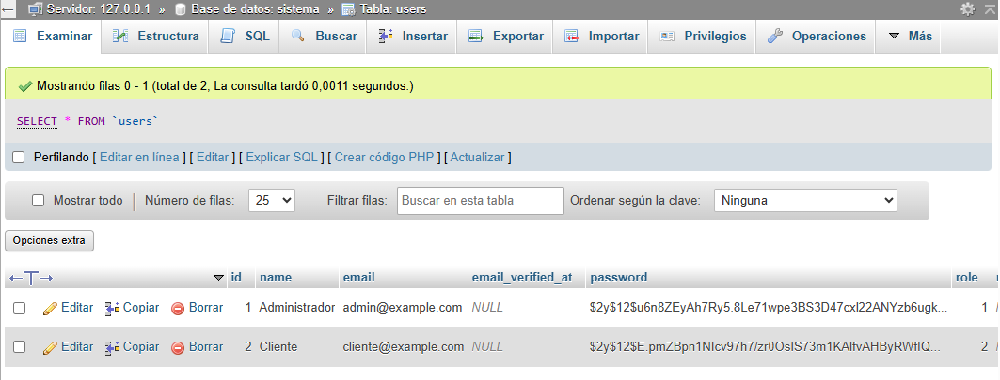

---

### 6.2 Actividad 2: instalación de Spatie laravel-permission

Para esta parte se creó un **proyecto nuevo**, con autenticación básica, y se instaló el paquete:

```bash
composer create-project laravel/laravel sistema-spatie
cd sistema-spatie
# .env -> DB_CONNECTION=mysql, DB_DATABASE=sistema_spatie, DB_USERNAME=root, DB_PASSWORD=
composer require laravel/ui
php artisan ui bootstrap --auth
composer require spatie/laravel-permission
```


La guía pide registrar `Spatie\Permission\PermissionServiceProvider::class` en `config/app.php`. En Laravel 12 ese paso **no es necesario**, porque el paquete se registra automáticamente.

Después se publicaron el archivo de configuración (`config/permission.php`) y la migración que crea las tablas del paquete:

```bash
php artisan vendor:publish --provider="Spatie\Permission\PermissionServiceProvider"
php artisan migrate
```


`config/permission.php` define los modelos `Role` y `Permission` y los nombres de las tablas. La migración creó **5 tablas** junto a las demás de Laravel:

| Tabla | Contenido |
|---|---|
| `permissions` | Los permisos (por ejemplo `destroy_notes`) |
| `roles` | Los roles (por ejemplo `Administrator`) |
| `role_has_permissions` | Qué permisos tiene cada rol |
| `model_has_roles` | Qué roles tiene cada usuario |
| `model_has_permissions` | Permisos asignados directamente a un usuario |


---

### 6.3 Actividad 3: uso del paquete (notas, rol Administrator y permiso `destroy_notes`)

Se implementó un ejemplo donde solo el rol **Administrator** puede eliminar notas.

**Modelo y migración `Note`.** La guía crea el modelo con `php artisan make:model Note -m` y completa el método `up()` de la migración:


<details><summary>Ver código: <code>database/migrations/..._create_notes_table.php</code></summary>

```php
<?php

use Illuminate\Database\Migrations\Migration;
use Illuminate\Database\Schema\Blueprint;
use Illuminate\Support\Facades\Schema;

return new class extends Migration
{
    public function up(): void
    {
        Schema::create('notes', function (Blueprint $table) {
            $table->increments('id');
            $table->string('title');
            $table->text('content');
            $table->timestamps();
        });
    }

    public function down(): void
    {
        Schema::dropIfExists('notes');
    }
};
```

</details>
<details><summary>Ver código: <code>app/Models/Note.php</code></summary>

```php
<?php

namespace App\Models;

use Illuminate\Database\Eloquent\Model;

class Note extends Model
{
    // Campos que se pueden rellenar de forma masiva
    protected $fillable = ['title', 'content'];
}
```

</details>

**Trait `HasRoles` en el modelo `User`.** Agrega al usuario los métodos para trabajar con roles y permisos (`assignRole`, `hasRole`, `hasPermissionTo`, `can`...):


<details><summary>Ver código: <code>app/Models/User.php</code></summary>

```php
<?php

namespace App\Models;

use Illuminate\Database\Eloquent\Factories\HasFactory;
use Illuminate\Foundation\Auth\User as Authenticatable;
use Illuminate\Notifications\Notifiable;
use Spatie\Permission\Traits\HasRoles; // Trait del paquete spatie/laravel-permission

class User extends Authenticatable
{
    // HasRoles agrega assignRole(), hasRole(), hasPermissionTo(), can(), etc.
    use HasFactory, Notifiable, HasRoles;

    protected $fillable = [
        'name',
        'email',
        'password',
    ];

    protected $hidden = [
        'password',
        'remember_token',
    ];

    protected function casts(): array
    {
        return [
            'email_verified_at' => 'datetime',
            'password' => 'hashed',
        ];
    }
}
```

</details>

**Creación del rol, el permiso y los usuarios.** La guía lo hace en la consola interactiva `php artisan tinker`:

```php
use Spatie\Permission\Models\Role;
use Spatie\Permission\Models\Permission;

$role = Role::create(['name' => 'Administrator']);            // rol
Permission::create(['name' => 'destroy_notes']);              // permiso
$role->givePermissionTo('destroy_notes');                     // el rol recibe el permiso
$role->hasPermissionTo('destroy_notes');                      // true

$user = User::create(['name' => 'Styde', 'email' => 'admin@styde.net', 'password' => 'secret']);
$user->assignRole('Administrator');                           // el usuario recibe el rol
```


Para poder repetir la prueba, esos mismos pasos se dejaron en el `DatabaseSeeder` (con `firstOrCreate`, de modo que se puede ejecutar más de una vez). Además crea un usuario **sin rol** (Joe), el rol `cliente` y el rol `empleado` con el permiso `validar_venta`, que se usan en la parte final de la guía:


<details><summary>Ver código: <code>database/seeders/DatabaseSeeder.php</code></summary>

```php
<?php

namespace Database\Seeders;

use App\Models\Note;
use App\Models\User;
use Illuminate\Database\Seeder;
use Spatie\Permission\Models\Permission;
use Spatie\Permission\Models\Role;
use Spatie\Permission\PermissionRegistrar;

class DatabaseSeeder extends Seeder
{
    /**
     * Reemplaza los pasos hechos a mano con "php artisan tinker" en la guía:
     * crea roles, permisos, usuarios y una nota de ejemplo.
     */
    public function run(): void
    {
        // Limpia la caché de permisos de Spatie
        app()[PermissionRegistrar::class]->forgetCachedPermissions();

        // ---- Permisos ----
        Permission::firstOrCreate(['name' => 'destroy_notes']); // Actividad 3
        Permission::firstOrCreate(['name' => 'validar_venta']); // Guía Spatie (empleado)

        // ---- Roles ----
        $administrator = Role::firstOrCreate(['name' => 'Administrator']);
        $administrator->givePermissionTo('destroy_notes');

        Role::firstOrCreate(['name' => 'cliente']);

        $empleado = Role::firstOrCreate(['name' => 'empleado']);
        $empleado->givePermissionTo('validar_venta');

        // ---- Usuarios de prueba (password: 12345678) ----
        $admin = User::firstOrCreate(
            ['email' => 'admin@styde.net'],
            ['name' => 'Styde', 'password' => '12345678']
        );
        $admin->assignRole('Administrator');

        // Joe: sin rol ni permisos (para comprobar que no puede eliminar notas)
        User::firstOrCreate(
            ['email' => 'joe@example.com'],
            ['name' => 'Joe', 'password' => '12345678']
        );

        $cliente = User::firstOrCreate(
            ['email' => 'cliente@example.com'],
            ['name' => 'Cliente', 'password' => '12345678']
        );
        $cliente->assignRole('cliente');

        $empl = User::firstOrCreate(
            ['email' => 'empleado@example.com'],
            ['name' => 'Empleado', 'password' => '12345678']
        );
        $empl->assignRole('empleado');

        // ---- Nota de ejemplo ----
        Note::create([
            'title' => 'Titulo de la nota',
            'content' => 'Contenido de la nueva nota',
        ]);
    }
}
```

</details>

**Controlador y vista de notas.** `NotesController` tiene el método `index`, que lista las notas, y `destroy`, que elimina una. En la vista, la directiva `@can('destroy_notes')` muestra el botón **Eliminar nota** solo a quien tiene el permiso; los demás ven un mensaje:


<details><summary>Ver código: <code>app/Http/Controllers/NotesController.php</code></summary>

```php
<?php

namespace App\Http\Controllers;

use App\Models\Note;

class NotesController extends Controller
{
    /**
     * Lista las notas. El enlace "Eliminar" solo se muestra
     * si el usuario tiene el permiso destroy_notes (@can en la vista).
     */
    public function index()
    {
        $notes = Note::all();

        return view('notes.index', compact('notes'));
    }

    /**
     * Elimina una nota. La ruta está protegida con el middleware
     * "permission:destroy_notes" (ver routes/web.php).
     */
    public function destroy($id)
    {
        Note::findOrFail($id)->delete();

        return redirect()->back();
    }
}
```

</details>
<details><summary>Ver código: <code>resources/views/notes/index.blade.php</code></summary>

```html
@extends('layouts.app')

@section('content')
<div class="container">
    <h2>Listado de notas</h2>

    <table class="table">
        <thead>
            <tr>
                <th>ID</th>
                <th>Título</th>
                <th>Acción</th>
            </tr>
        </thead>
        <tbody>
            @foreach ($notes as $note)
                <tr>
                    <td>{{ $note->id }}</td>
                    <td>{{ $note->title }}</td>
                    <td>
                        {{-- @can verifica si el usuario tiene el permiso destroy_notes --}}
                        @can('destroy_notes')
                            <form action="{{ route('notes.destroy', $note->id) }}" method="POST">
                                @csrf
                                @method('DELETE')
                                <button class="btn btn-danger btn-sm">Eliminar nota</button>
                            </form>
                        @else
                            Usted no puede eliminar esta nota
                        @endcan
                    </td>
                </tr>
            @endforeach
        </tbody>
    </table>
</div>
@endsection
```

</details>

**Registro del middleware.** La guía crea un `PermissionMiddleware` propio y lo registra en `Kernel.php`. En Laravel 12 no existe el Kernel y Spatie ya trae sus middleware, por lo que basta con registrar los alias en `bootstrap/app.php`:


<details><summary>Ver código: <code>bootstrap/app.php</code></summary>

```php
<?php

use Illuminate\Foundation\Application;
use Illuminate\Foundation\Configuration\Exceptions;
use Illuminate\Foundation\Configuration\Middleware;

return Application::configure(basePath: dirname(__DIR__))
    ->withRouting(
        web: __DIR__.'/../routes/web.php',
        commands: __DIR__.'/../routes/console.php',
        health: '/up',
    )
    ->withMiddleware(function (Middleware $middleware): void {
        // Los alias de middleware de Spatie se registran aquí.
        $middleware->alias([
            'role' => \Spatie\Permission\Middleware\RoleMiddleware::class,
            'permission' => \Spatie\Permission\Middleware\PermissionMiddleware::class,
            'role_or_permission' => \Spatie\Permission\Middleware\RoleOrPermissionMiddleware::class,
        ]);
    })
    ->withExceptions(function (Exceptions $exceptions): void {
        //
    })->create();
```

</details>

**Rutas protegidas.** Sin protección, un usuario sin el permiso podría entrar a la ruta de eliminar escribiendo la URL aunque no vea el botón. Por eso la ruta de eliminar está dentro de un grupo con el middleware `permission:destroy_notes`: quien no tiene el permiso recibe un error **403**. También se protegió una ruta con el middleware `role:cliente`, y la vista `/tienda` comprueba el rol con `hasRole()` y el permiso con `hasPermissionTo()`:


<details><summary>Ver código: <code>routes/web.php</code></summary>

```php
<?php

use App\Http\Controllers\HomeController;
use App\Http\Controllers\NotesController;
use Illuminate\Support\Facades\Auth;
use Illuminate\Support\Facades\Route;

Route::get('/', function () {
    return view('welcome');
});

Auth::routes();

Route::get('/home', [HomeController::class, 'index'])
    ->middleware('auth')
    ->name('home');

// ---------- Actividad 3: notas y permiso destroy_notes ----------
Route::middleware('auth')->group(function () {
    Route::get('/notes', [NotesController::class, 'index'])->name('notes.index');
});

// Ruta protegida: sin el permiso destroy_notes el usuario recibe error 403
Route::middleware(['auth', 'permission:destroy_notes'])->group(function () {
    Route::delete('/notes/{id}', [NotesController::class, 'destroy'])->name('notes.destroy');
});

// ---------- Guía Spatie: roles cliente / empleado ----------
// Solo los usuarios con rol "cliente" entran a este grupo de rutas
Route::middleware(['auth', 'role:cliente'])->group(function () {
    Route::get('/tienda/cliente', function () {
        return 'Zona exclusiva para clientes registrados';
    })->name('tienda.cliente');
});

// Vista que muestra contenido según rol y permiso
Route::get('/tienda', function () {
    return view('tienda');
})->middleware('auth')->name('tienda');
```

</details>
<details><summary>Ver código: <code>resources/views/tienda.blade.php</code></summary>

```html
@extends('layouts.app')

@section('content')
<div class="container">
    <h2>Tienda</h2>

    {{-- Comprobación por ROL --}}
    @if (Auth::user()->hasRole('cliente'))
        <h4>Eres un cliente</h4>
    @endif

    {{-- Comprobación por PERMISO --}}
    @if (Auth::user()->hasPermissionTo('validar_venta'))
        <button class="btn btn-primary">Validar venta</button>
    @endif
</div>
@endsection
```

</details>

**Métodos útiles del paquete** (según la guía):

```php
$role->hasPermissionTo('destroy_notes');     // ¿el rol tiene el permiso? (true / false)
$role->revokePermissionTo('destroy_notes');  // quita el permiso al rol
```

---

## 7. Funcionamiento de las aplicaciones

En esta sección se muestra cada aplicación en ejecución (con `php artisan serve` en `http://127.0.0.1:8000`), siguiendo el recorrido de un usuario: entrar con cada rol y comprobar qué puede ver y qué no puede hacer. Las contraseñas de todos los usuarios de prueba son `12345678`.

Se construyeron dos proyectos: `sistema` (Actividad 1, Gates, base de datos `sistema`) y `sistema-spatie` (Actividades 2 y 3, Spatie, base de datos `sistema_spatie`).

### 7.1 Actividad 1: menú dinámico con Gates

Se abre `/login` del proyecto `sistema` y se ingresan el correo y la contraseña de uno de los dos usuarios creados por el seeder.


Al entrar con `admin@example.com` (**role 1, administrador**), el menú muestra solo la opción **Mantenimiento**, porque el `@can('mantenimiento')` del layout es el único que se cumple.

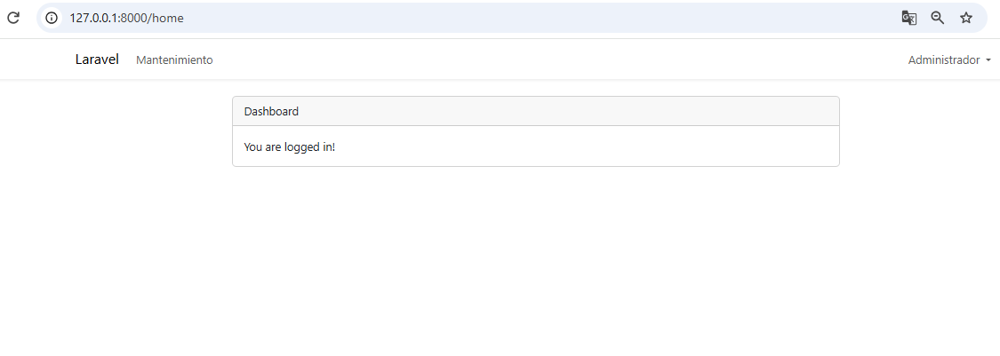

Al entrar con `cliente@example.com` (**role 2, cliente**), el menú muestra solo la opción **Pedidos**.

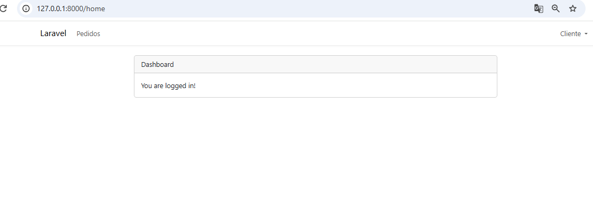

Con el administrador, la opción Mantenimiento abre su sección; con el cliente, la opción Pedidos abre la suya.

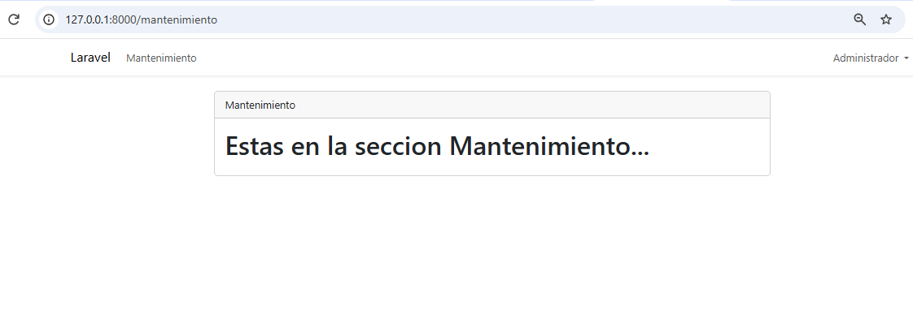
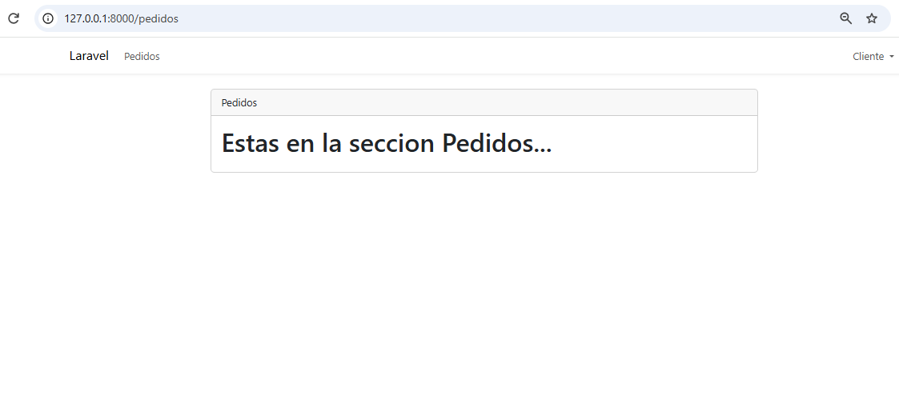

Como ocultar el enlace no basta, se probó la ruta directamente: con la sesión del cliente se escribió `http://127.0.0.1:8000/mantenimiento` en la barra de direcciones. Gracias a `Gate::authorize('mantenimiento')`, la aplicación responde con el error **403** en lugar de mostrar la vista.

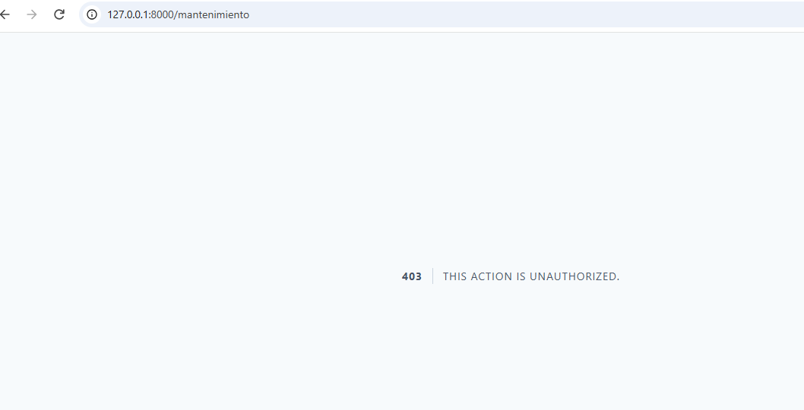

**Base de datos y registro.** La tabla `users` de la base `sistema` tiene la columna `role` (entero, valor predeterminado 1), y el formulario `/register` crea usuarios nuevos con ese rol.

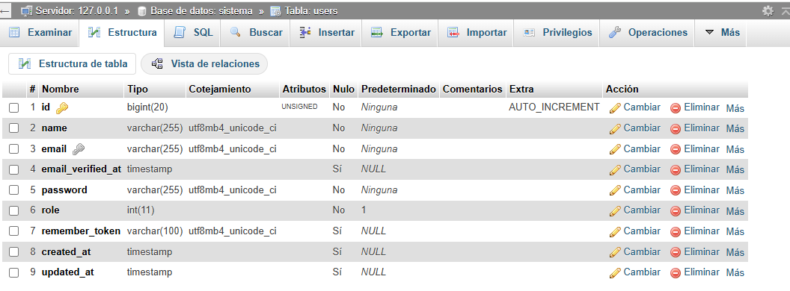
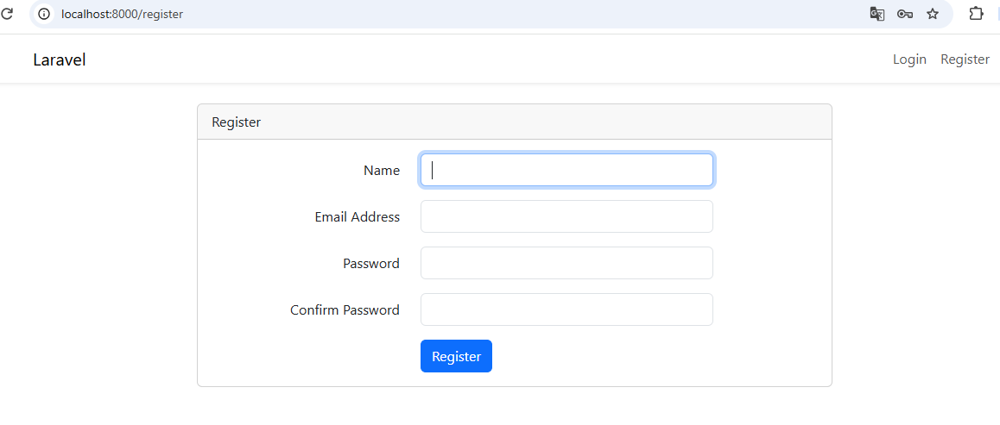

### 7.2 Actividad 2: instalación de Spatie

Con el paquete instalado y las migraciones ejecutadas en el proyecto `sistema-spatie`, phpMyAdmin muestra las 5 tablas creadas por Spatie en la base `sistema_spatie`. Las Actividades 2 y 3 usan este mismo proyecto y esta misma base de datos.


### 7.3 Actividad 3: roles y permisos con Spatie

Pruebas realizadas en el proyecto `sistema-spatie`:

1. `http://localhost:8000/notes`: con `admin@styde.net` se ve el botón «Eliminar nota»; con `joe@example.com` se ve «Usted no puede eliminar esta nota».
2. Intentar borrar sin permiso (middleware `permission:destroy_notes`): responde 403.
3. `http://localhost:8000/tienda`: el cliente ve «Eres un cliente» y el empleado ve el botón «Validar venta».
4. `http://localhost:8000/tienda/cliente`: solo el rol `cliente` entra; los demás reciben 403.

**Usuario con el permiso.** Al entrar con `admin@styde.net` (rol Administrator) y abrir `/notes`, se muestra el botón **Eliminar nota**.

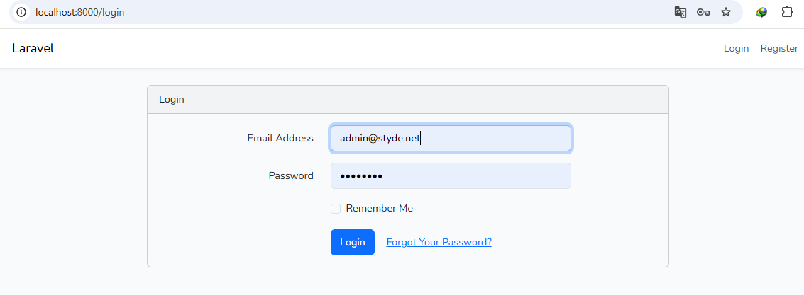
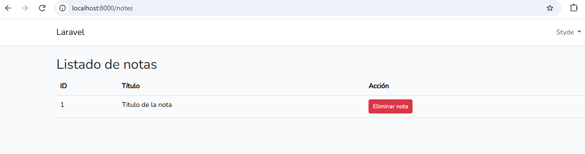

**Usuario sin rol ni permisos.** Al entrar con `joe@example.com` y abrir `/notes`, aparece el mensaje «Usted no puede eliminar esta nota».

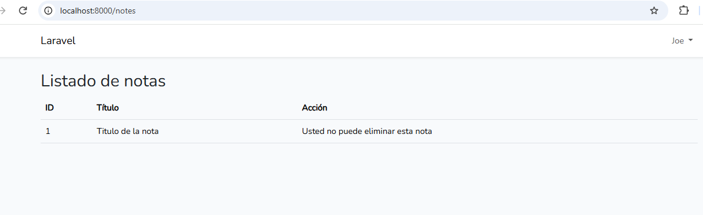

**Protección de la ruta.** Joe intenta eliminar la nota sin tener el permiso (enviando la solicitud DELETE a `/notes/1` desde la terminal): el middleware `permission:destroy_notes` responde con un error **403 Forbidden** y la nota no se elimina.


**Eliminación con permiso.** Con el administrador, al pulsar **Eliminar nota** la nota se borra y se regresa a la lista.

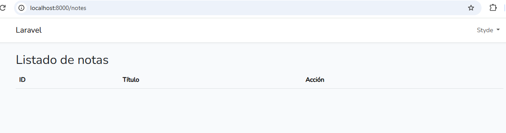

**Roles `cliente` y `empleado`.** En `/tienda`, el usuario `cliente@example.com` ve el texto «Eres un cliente»; el usuario `empleado@example.com` ve el botón **Validar venta**, porque su rol tiene el permiso `validar_venta`.

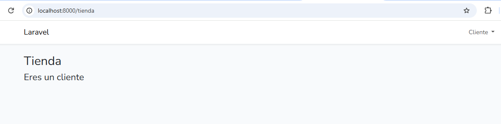
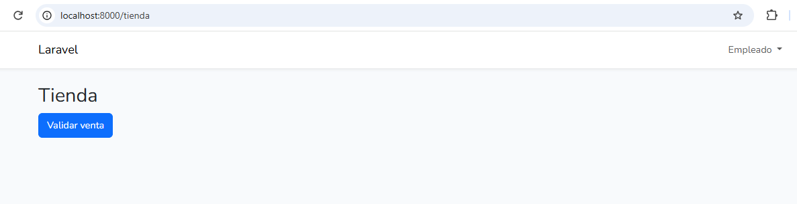

La ruta `/tienda/cliente` solo permite el acceso al rol `cliente`; con cualquier otro rol responde con un error **403**.

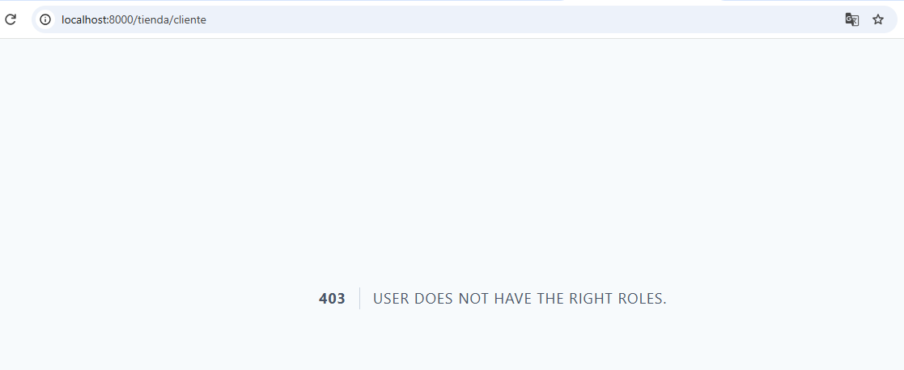

**Evidencia en la base de datos `sistema_spatie`.** Los datos que crea el seeder: los roles Administrator, cliente y empleado; los permisos `destroy_notes` y `validar_venta`; y la tabla `model_has_roles`, que indica qué rol tiene cada usuario.

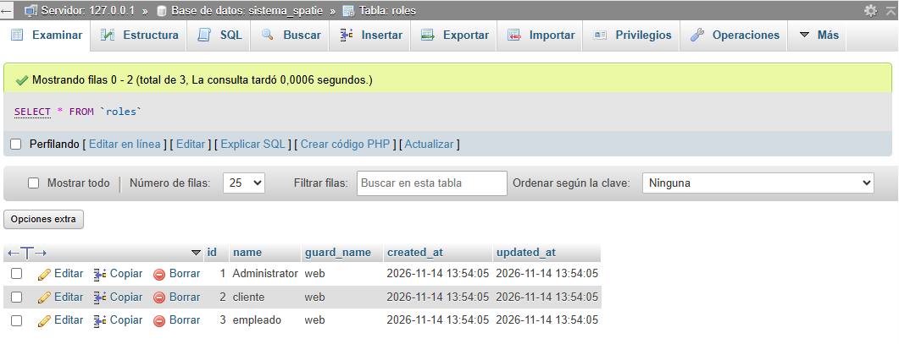
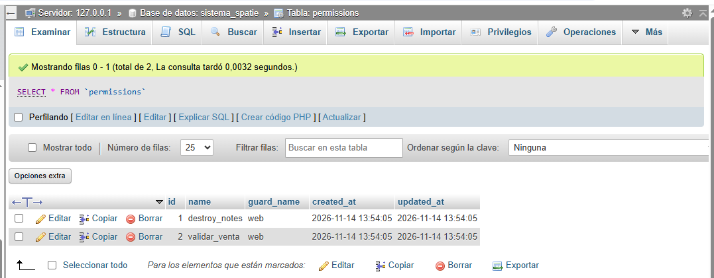
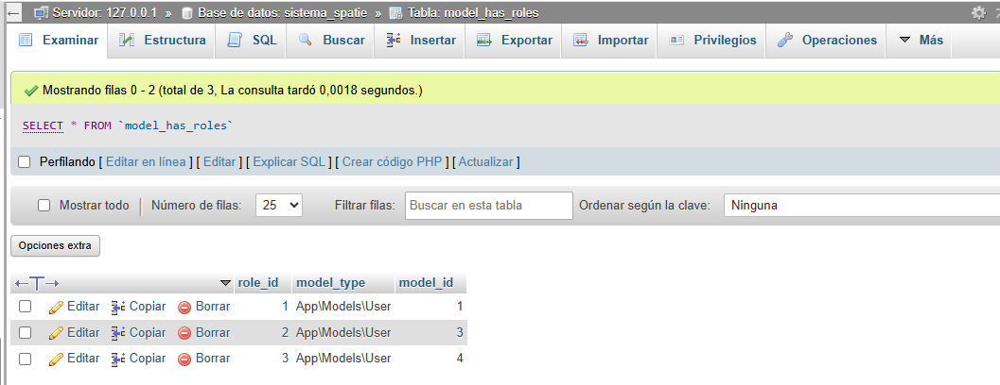


## 8. Conclusiones

- La **autorización** decide qué puede hacer un usuario ya autenticado; en Laravel se puede resolver con Gates o con un paquete de roles y permisos como Spatie.
- Los **Gates** se definen en un solo lugar (`AppServiceProvider` en Laravel 12) y se usan igual en vistas (`@can`) y en rutas (`Gate::authorize`). Son simples y suficientes cuando hay pocas reglas, pero los roles quedan escritos en el código (columna `role` y constantes).
- **Ocultar un enlace del menú no basta:** sin `Gate::authorize` o sin el middleware `permission`, cualquier usuario puede entrar escribiendo la URL. La seguridad real está en proteger la ruta; el `@can` solo mejora la experiencia de usuario.
- **Spatie laravel-permission** guarda roles y permisos en la base de datos (5 tablas), lo que permite crearlos, asignarlos y quitarlos sin modificar el código, y ofrece los middleware `role` y `permission` listos para usar.
- Laravel 12 cambia varios pasos de la guía (sin `AuthServiceProvider`, sin `Kernel.php` y con registro automático de paquetes); identificar esas diferencias fue necesario para que las actividades funcionaran.

---

## 9. Repositorio

Código fuente completo en este repositorio. Las carpetas `sistema/` y `sistema-spatie/` contienen los dos proyectos Laravel; los archivos de código comentados de cada actividad están además en `codigo/`.
